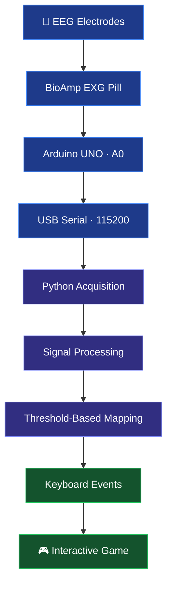
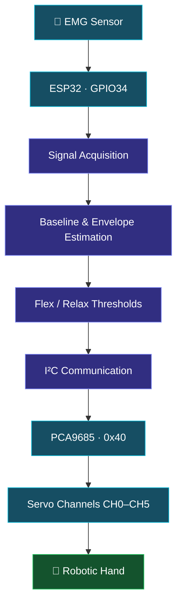

# 🧠 NeuroDive
### Beyond Physical Interaction — Towards Brain & Muscle Controlled Computing

<p align="center">
  <strong>An Experimental Hybrid Brain-Computer & Muscle-Computer Interface</strong>
</p>

<p align="center">
  
  
  
  
</p>

<p align="center">
  <em>Connecting neural activity, muscle signals, artificial intelligence, and interactive robotics.</em>
</p>

---

## 🌌 The Vision

What if interacting with a computer didn't always require a keyboard, mouse, or conventional controller?

**NeuroDive** explores an alternative approach to human-computer interaction by combining Brain-Computer Interface (BCI) and Muscle-Computer Interface (MCI) technologies.

The project is an experimental hybrid biosignal-control platform with two independent interaction pathways:

- 🧠 **EEG (Brain Signals):** Acquires signals through a BioAmp-based setup and translates prototype signal patterns into keyboard commands for an interactive game.
- 💪 **EMG (Muscle Signals):** Detects muscle activity and uses it to control a servo-driven robotic hand.

Our objective is to explore how biological signals can become meaningful digital and physical interactions.

> **Our philosophy:** Don't just interact with technology. Explore new ways to connect with it.

---

## ✨ Core Capabilities

| Module | Function | Technology |
|---|---|---|
| 🧠 EEG Acquisition | Captures brain-signal-path data | BioAmp EXG Pill |
| 📡 Data Transmission | Transfers acquired samples | Arduino UNO |
| 🐍 Signal Processing | Processes incoming data | Python, NumPy |
| 🎮 Game Interaction | Converts signal thresholds into keyboard events | PyAutoGUI |
| 💪 EMG Acquisition | Reads muscle activity | ESP32 |
| 🤖 Robotic Control | Drives multiple servo channels | PCA9685 |
| ⚡ Motor Interface | Controls robotic hand movement | Servo motors |

---

## 🏗️ System Architecture

NeuroDive uses two separate biosignal pathways that explore different forms of interaction.

### 01 — 🧠 EEG to Virtual Interaction

The EEG pathway connects the acquisition hardware to a Python-based control system.



**How it works:**

1. EEG electrodes capture electrical activity from the scalp.
2. BioAmp EXG Pill provides the acquisition interface.
3. Arduino UNO reads the analog output through pin A0.
4. Samples are transmitted to Python over USB serial.
5. The software processes the incoming values.
6. A prototype threshold-based controller maps signal ranges to keyboard commands.
7. The game responds to the generated keyboard events.

**Current configuration**

| Parameter | Configuration |
|---|---|
| Acquisition board | Arduino UNO |
| Signal interface | BioAmp EXG Pill |
| Analog input | A0 |
| Serial baud rate | 115200 |
| Sampling target | 250 Hz |
| Demonstrated port | COM6 |
| Control library | PyAutoGUI |

### 02 — 💪 EMG to Robotic Interaction

The EMG pathway explores muscle-controlled physical interaction through a servo-driven robotic hand.



**How it works:**

1. The EMG sensor acquires muscle activity.
2. ESP32 reads the analog signal through GPIO34.
3. The software estimates a baseline and signal deviation.
4. Flex and relaxation thresholds determine the control state.
5. Commands are communicated through I²C.
6. PCA9685 generates PWM signals for the connected servo channels.
7. The robotic hand responds to the motor commands.

**Current configuration**

| Parameter | Configuration |
|---|---|
| Controller | ESP32 |
| EMG analog input | GPIO34 |
| I²C SDA | GPIO21 |
| I²C SCL | GPIO22 |
| PWM driver | PCA9685 |
| I²C address | 0x40 |
| Programmed channels | CH0–CH5 |
| PWM frequency | 50 Hz |
| Motor interface | Servo motors |

*Note: Six programmed channels do not necessarily mean six physical motors are installed. Verify the actual hardware configuration.*

---

## 🔬 Development & Experimental Progress

We believe engineering progress should be transparent. The following table distinguishes observed functionality from project-owner-reported progress and outstanding validation.

| Development milestone | Status |
|---|---|
| EEG-path serial acquisition | ✅ Demonstrated |
| Python serial communication | ✅ Demonstrated |
| Keyboard event generation | ✅ Demonstrated |
| EEG-derived command reliability | 🟡 Needs validation |
| EMG acquisition | 🟡 Reported completed |
| PCA9685 servo movement | ✅ Reported working in standalone tests |
| EMG-driven robotic hand | 🟡 Reported completed |
| Hybrid EEG + EMG integration | 🟡 End-to-end verification pending |

### 📊 EEG Acquisition — Observed Results

During the demonstrated serial acquisition test, Python successfully received 50 numerical readings from Arduino UNO.

| Measurement | Observed value |
|---|---:|
| Minimum | 0 |
| Maximum | 87 |
| Mean | 31.4 |
| Standard deviation | 38.81 |
| Received samples | 50 |

Example observed pattern:

```text
0, 0, 0, 85, 80, ...
```

An ADC diagnostic also showed approximately:

- Grounded input: 0
- 3.3 V input: 675

These observations establish basic ADC and serial communication functionality. They do not establish that the recorded values represent clean, physiologically meaningful EEG.

Further signal-quality verification is required.

### 🎮 Prototype Keyboard Interaction

A standalone Python test successfully generated the following keyboard events:

| Key | Prototype action |
|---|---|
| W | Forward |
| A | Left |
| S | Backward |
| D | Right |
| SPACE | Jump |

A subsequent threshold-based controller supported directional key holds of approximately three seconds and a SPACE tap for jumping.

**Important:** These are prototype signal-to-key mappings, not independently validated classifications of distinct mental intentions.

### 🤖 Robotic Servo Control

The ESP32 and PCA9685 implementation supports:

- Baseline calibration.
- Signal deviation estimation.
- Flex and relaxation thresholds.
- Servo position commands.
- Six programmed PWM channels.

Standalone servo movement was reported working. Successful end-to-end EMG flex/relax-to-motor operation has not yet been independently documented in the shared test logs.

---

## 🧰 Technology Stack

### Hardware

- Arduino UNO
- ESP32
- BioAmp EXG Pill
- EEG electrodes
- EMG sensor
- PCA9685 PWM servo driver
- Servo motors
- Computer for signal processing and control

### Software & Libraries

| Technology | Purpose |
|---|---|
| Python | Main processing environment |
| NumPy | Numerical computation |
| SciPy | Signal processing |
| Scikit-learn | Machine learning development |
| PyAutoGUI | Keyboard interaction |
| PySerial | Serial communication |
| Arduino IDE | Microcontroller programming |
| ESP32 Arduino Framework | EMG and motor control |

---

## 📂 Project Components

The development architecture includes the following software components:

```text
NeuroDive/
│
├── eeg/
│   ├── config.py
│   ├── record_data.py
│   ├── features.py
│   ├── train_model.py
│   ├── predict.py
│   └── signal_control.py
│
├── emg/
│   ├── emg_acquisition.ino
│   └── servo_control.ino
│
├── models/
│   ├── eeg_model.pkl
│   └── scaler.pkl
│
├── simulation/
│   └── game.py
│
├── hardware/
│   └── wiring_diagram.png
│
├── requirements.txt
└── README.md
```

*This is the logical component organization; adjust paths and filenames to match the actual repository.*

### Component responsibilities

- `config.py` — Acquisition configuration.
- `record_data.py` — EEG-path data recording.
- `features.py` — EEG feature extraction.
- `train_model.py` — Model training.
- `predict.py` — Serial diagnostic in the previously demonstrated version; not yet established as a trained-model inference runtime.
- `signal_control.py` — Serial-to-keyboard prototype controller.
- `emg_acquisition.ino` — ESP32 EMG acquisition.
- `servo_control.ino` — PCA9685 servo-control implementation.
- `eeg_model.pkl` and `scaler.pkl` — Previously mentioned model assets; their current runtime usage and evaluation remain to be verified.

---

## 🛣️ Roadmap

NeuroDive is being developed as an expandable experimental platform.

| Phase | Development objective |
|---|---|
| Phase 01 | EEG and EMG acquisition |
| Phase 02 | Signal conditioning and processing |
| Phase 03 | Reliable EEG and EMG command recognition |
| Phase 04 | Game and robotic hand interaction |
| Phase 05 | Synchronized hybrid control |
| Phase 06 | Advanced 3D and VR integration |
| Phase 07 | Improved adaptive biosignal interaction |

### 🔭 Future Vision

Our long-term ambition is to expand NeuroDive into an immersive neurotechnology platform.

Potential future applications include:

- **Immersive Gaming:** Exploring neural interaction in virtual environments.
- **Assistive Technology:** Investigating alternative input mechanisms for people with limited physical mobility.
- **Robotic Assistance:** Exploring biosignal-driven robotic control.
- **Neurorehabilitation Research:** Investigating interactive feedback for motor-learning environments.
- **Human-Computer Interaction:** Exploring more intuitive interfaces between humans and digital systems.

These are research directions, not established clinical capabilities.

---

## ⚠️ Electrical Safety & Experimental Limitations

NeuroDive is an experimental engineering prototype. It is not a validated medical device, diagnostic system, or clinically approved rehabilitation solution.

Before operating the hardware:

- Never apply 5 V or negative voltage directly to ESP32 GPIO34.
- Verify the EMG sensor's output voltage before connecting it to the ESP32 ADC.
- An EMG module powered from ±9 V rails does not automatically produce an ESP32-safe output.
- Use a properly rated, dedicated power supply for servo motors.
- High-torque servos can draw substantial current, particularly when multiple motors operate simultaneously.
- Provide a physical motor-power cutoff.
- Test robotic mechanisms without wearing them.
- Do not connect unverified DIY electrode systems to a person through a USB-connected computer setup without appropriate electrical isolation and safety measures.

**Signal integrity, electrical safety, repeatability, and end-to-end performance must be validated before making stronger performance claims.**

---

## 🎯 Project Summary

NeuroDive brings together two experimental interaction pathways:

<pre>
       🧠 BRAIN SIGNALS
             |
          EEG PATH
             |
       PYTHON PROCESSING
             |
       GAME INTERACTION
             |
       VIRTUAL WORLD


       💪 MUSCLE SIGNALS
             |
          EMG PATH
             |
          ESP32
             |
          PCA9685
             |
       ROBOTIC HAND
</pre>

The project has established important building blocks involving serial biosignal-path acquisition, software keyboard actuation, and standalone servo movement. Additional integration and physiological signal validation remain important development objectives.

We are exploring a future where human biological signals can become an alternative interface for interacting with intelligent digital and robotic systems.

---

<p align="center">
  <h2 align="center">🧠 NEURODIVE</h2>
  <h3 align="center">BEYOND PHYSICAL INTERACTION.</h3>
  <p align="center"><em>Connecting Human Signals with Intelligent Machines.</em></p>
</p>

<p align="center">
  Built with curiosity, experimentation, and a vision for the future of human-computer interaction.
</p>

<p align="center">
  <strong>Experimental Research Project · BCI · EMG · AI · Robotics</strong>
</p>
